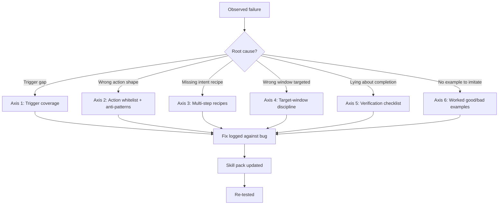

# Agent Reliability Notes

**Failure modes and design patterns observed while building agentic LLM systems, and what happened when I measured them.**

*The notes are open; the underlying product codebase is private. The evaluation that tests these notes is public, with code and data:
[beepsme-verification-gate-eval](https://github.com/AlishbaFatima12/beepsme-verification-gate-eval)
([interactive results](https://alishbafatima12.github.io/beepsme-verification-gate-eval/);
technical report: [doi:10.5281/zenodo.23840739](https://doi.org/10.5281/zenodo.23840739)).*

> **Maintainer:** Syeda Alishba Fatima · Karachi, Pakistan
> **Contact:** alishbafatima25@gmail.com
> **Status:** Active research log · first written May 2026 · updated October 2026 with measured results

---

## Why this repository exists

I study when people can trust what an LLM agent tells them about its own work. Over the past two years I
have built three agentic LLM systems and kept seeing the same pattern: the agent's report ("done",
"I can't help") and what actually happened come apart. These notes record that pattern, the design
pattern I introduced in response, what a measured evaluation later showed, and the questions that remain.

I do not claim these observations are unique discoveries. I claim they are real, written down before I
tested them, and research-relevant. I publish them to make them citable and to invite correction.

---

## The system under study: BeepSME

BeepSME is a voice-first Windows assistant I designed and built, publicly released at
[beepsme.com](https://beepsme.com) in August 2026. It acts on the computer for its user (teaches the page on
screen, solves homework into a Word document, reads aloud, translates, writes documents, sends messages) in
41 languages, with Urdu as its first. The codebase is private; what follows is the research-relevant
architecture.

### Architecture at a glance

```
  Voice input (speech-to-text) ─┐
  Screen perception (vision)  ──┼──►  Router: picks skill packs + a model tier per request
  Persistent memory          ──┘            │   (about 26 skill packs; basic and smart tiers)
                                            ▼
                               Agent loop: plan → act → look again
                                            │
                                            ▼
                       End-of-task verdict: "ok" unless a step recorded a failure
                                            │
                                            ▼
                         Report to the user: "Done!" or the failure reason
```

Three properties matter for the observations below:

- **One agent loop, many skills.** Each request loads only the skill packs it needs (Python modules holding
  the skill's prompt, triggers and allowed actions) and a model tier. There is no multi-agent orchestration.
- **Voice, vision and memory.** The agent hears requests, reads the screen, and keeps memory across sessions.
- **The verdict checks that nothing broke, not that the result is right.** The end-of-task decision is
  `task_succeeded = not failure_reason`; it is the only feedback many users ever receive.

---

## The core observation, as first written (May 2026)

> **The agent fails most confidently exactly where it should be least certain.**

On tasks with several dependent steps, the agent would emit a completion signal after the easiest step
and report success in fluent language unrelated to whether the task was done. The fluency of the report
and the correctness of the action were decoupled.

### The two-regime failure (design observation)

Attempts to engineer this away with structured prompting and verification gates produced a second
failure: the agent began deferring on tasks it could handle.

```
   Lenient verification      →  over-confidence:  "I did it!"  (but didn't)
            │  tighten prompts and gates
            ▼
   Aggressive verification   →  over-deferral:    "I can't help" (but could)
```

My May hypothesis was that both regimes share one cause: **the agent has no calibrated signal of its own
uncertainty**, so a gate is a heuristic, not a guarantee.

---

## What measurement showed (October 2026)

I wrote a 44-task protocol with an oracle for every task in June 2026, ran it in August, and scored 31 trials
against world state (files, captured speech, the screen). The full analysis, data, tests and an interactive
page are in
[beepsme-verification-gate-eval](https://github.com/AlishbaFatima12/beepsme-verification-gate-eval). In short:

| Finding | Status of the May note |
|---|---|
| The agent's real verdict was right on 68% of trials, with 5 false "done" and 5 false "failed" reports. | **Supported:** it errs in both directions. |
| Every false "failed" came from an infrastructure error after the content had been delivered; 4 of 5 false "done" were tasks that could not be done at all. The verdict has no "declined" outcome, so an honest refusal and a silent no-op both end as success. | **Refined:** the failure is partly *expressive*, not only calibrational. |
| A post-hoc self-confidence score ranked successes above failures (ROC AUC 0.80); mean confidence was lower on failures. | **Not supported:** confidence was *not* highest where the agent was wrong. |
| Every decision rule tried (the logged field, the verdict, confidence thresholds) traded one error type for the other; none kept both low. | **Supported, post hoc:** the trade-off is real, but this comparison was not pre-specified. |
| A blind human second rating agreed with the LLM rater on 6 of 8 decidable trials (Cohen's kappa 0.47); raters disagreed on what counts as success, e.g. a poem spoken aloud when a document was asked for. | **New:** what counts as success is itself a feedback question. |

The study also caught my own mistake: my first analysis used a logging field that turned out to be hardcoded
to "success". I traced it, re-derived the real verdicts from the run logs, and published the defect with
the corrected numbers.

---

## The six-axis skill specification pattern

In response to failures seen during development, I constrain each skill pack along six axes. The pattern is
applied **incrementally**, one fix per surfaced bug and never as a mass rewrite, and each fix is logged
against its originating failure, so the system accumulates structured evidence of where agentic LLMs fail.



| # | Axis | What it constrains | What failure it catches |
|---|------|--------------------|-------------------------|
| 1 | Trigger coverage | Phrasings (in many languages) that activate the skill | Misrouted requests |
| 2 | Action whitelist + anti-patterns | Permitted action types; shapes that fail silently | Silent action errors, invented actions |
| 3 | Multi-step recipes | Concrete action sequences for the top intents | Premature completion |
| 4 | Target-window discipline | Verify focus before any state-changing action | Acting on the wrong window |
| 5 | Verification checklist before completion | A required check between the final action and "done" | Fluent-but-incorrect reports |
| 6 | Paired worked examples (good / bad) | Real failures and successes as in-context anchors | Hallucinated execution patterns |

The pattern is engineering, not research. What is research-relevant is what it leaves unsolved: even with all
six axes, Axis 5 can only report what the system can check, and the measured study shows that its binary
outcome cannot express a correct refusal.

---

## Open research questions

### Q1. What should an agent's report say, and does its format help people catch mistakes?

A binary "done / failed" cannot represent "declined" or "done, but unverified". Which report formats
("done", "declined", a confidence score, or the evidence itself) help users notice an agent's errors, and
how does that change over a session? This calls for user studies, designed with the people who rely on the
agent, including learners working in Urdu.

### Q2. Can human and model feedback be combined to evaluate agent outcomes at scale?

My study used an LLM rater for every trial and a human for a random sample; they agreed moderately and
disagreed about what success means. Can self-reports, LLM judges and sparse human labels be combined while
learning how reliable each source is, and can we decide which outcomes need a human check? This connects to
hybrid human-AI evaluation (Mesbah et al., 2023) and routing between human and AI feedback (Miranda et al.,
2025).

### Q3. Calibrated abstention in multi-step agents

A gate is only as good as the signal that triggers it. What does principled abstention look like when the
agent is a multi-step pipeline rather than a single classifier, and when "abstain" must be a first-class
outcome? Selective classification (e.g. Rabanser & Papernot, 2025) treats the single-step case.

### Q4. Why do fluent reports decouple from actions?

When the agent reports success in language unrelated to what it did, which training influences produce the
fluency, and which the decoupling? This is a longer-term question about data attribution.

---

## Selected related work

| Paper | Venue | Connection to these notes |
|-------|-------|---------------------------|
| Mesbah, Arous, Yang & Bozzon, "HybridEval: A Human-AI Collaborative Approach for Evaluating Design Ideas at Scale" | WWW 2023 | Combining model and crowd judgements with sparse expert labels (Q2) |
| Miranda et al., "Hybrid Preferences: Learning to Route Instances for Human vs. AI Feedback" | ACL 2025 | Deciding which instances need human rather than AI feedback (Q2) |
| Li, Arous & Cheung, "Partial Perspectives: How LLMs Handle Logically Inconsistent Knowledge in Reasoning Tasks" | COLM 2025 | Most reasoning errors were omissions rather than hallucinations; relevant to grounded tutors |
| Rabanser & Papernot, "What Does It Take to Build a Performant Selective Classifier?" | arXiv 2025 | Abstention from the classifier side (Q3) |
| Rabanser et al., "Confidential Guardian: Cryptographically Prohibiting the Abuse of Model Abstention" | ICML 2025 | Abstention that can be misused, and how to verify it |
| Pouget, Yaghini, Rabanser & Papernot, "Suitability Filter" | ICML 2025 | Deployment-time evaluation of whether a model is fit for use |
| Sharma et al., "Towards Understanding Sycophancy in Language Models" | ICLR 2024 | Vocabulary for the fluent-but-incorrect failure mode |
| Benton et al., "Sabotage Evaluations for Frontier Models" | 2024 | Studying agent reliability as a research problem, not an engineering bug |

---

## Two earlier systems (brief)

Before BeepSME I built two related systems in the Panaversity Certified Agentic & Robotic AI Engineer
programme. They give context; they are not the subject of these notes.

**Teach Me Panel**: an LLM tutor restricted to teaching only from lesson material. A three-layer evaluation
(two LLM judges, a weighted rubric, scenario tests) showed an 80% aggregate score hiding failures on most of
14 edge-case scenarios: the aggregate answered the question I asked, not the one a student would ask.

**Personal AI Employee**: an agentic system for monitoring and decision support, built for traceability and
auditable state; a test bed for separating an agent's instruction context from its execution logic.

---

## Status of this work

- **System.** BeepSME is publicly released. The measured results come from a scripted evaluation of 31
  trials, not a user study.
- **Notes.** A research log, updated as failure modes surface. Not a paper.
- **Code.** The product codebase is private; the evaluation code and data are public (link above).

---

## Citation

```bibtex
@misc{fatima2026agentreliability,
  author = {Fatima, Syeda Alishba},
  title  = {Agent Reliability Notes: Failure modes and design patterns observed in BeepSME},
  year   = {2026},
  url    = {https://github.com/AlishbaFatima12/agent-reliability-notes}
}
```

---

## About the author

Syeda Alishba Fatima is an Assistant Director at the National Commission for Human Development (NCHD),
Pakistan, where she leads education and technology initiatives. She holds an MSc in Pure Mathematics from the
University of Karachi (Gold Medal, first in the department) and an MS in Computer Science and IT from NED
University, taught mathematics for nearly five years, and is applying for PhD entry in 2027.

**Contact:** alishbafatima25@gmail.com ·
**LinkedIn:** [linkedin.com/in/syeda-alishba-fatima-695711135](https://www.linkedin.com/in/syeda-alishba-fatima-695711135) ·
**GitHub:** [AlishbaFatima12](https://github.com/AlishbaFatima12)

---

*Corrections, counter-examples and pointers to relevant work are welcome.*
